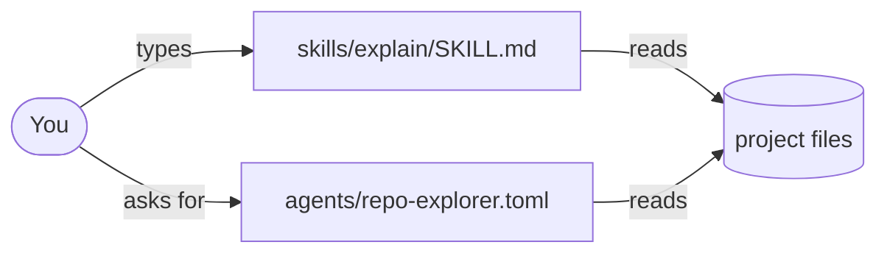

# Mermaid conventions

## Pick the diagram type

| The subject is... | Use | Starts with |
| --- | --- | --- |
| How parts connect (files, services, components) | Flowchart | `flowchart LR` |
| A process or decision path | Flowchart, top to bottom | `flowchart TD` |
| Who calls whom, in order (user, agent, tool) | Sequence diagram | `sequenceDiagram` |
| A folder or concept hierarchy | Mindmap | `mindmap` |
| States something moves through | State diagram | `stateDiagram-v2` |

When unsure, use `flowchart LR`.

## Style

- Node labels are short names or file paths, not sentences.
- Label every arrow with the relationship: `-- loads -->`, `-- delegates to -->`, `-- reads -->`.
- Use shapes consistently: `[ ]` for files, `([ ])` for people or tools, `{ }` for decisions, `[( )]` for data stores.
- Group related nodes with `subgraph Name ... end`, for example one subgraph per folder.
- Show a missing or broken reference as a dashed arrow `-.->` with a label such as `missing`.

## Syntax rules that prevent render errors

- Node IDs are plain letters, numbers, or underscores: `cmd1`, `agent_explorer`. Put the readable text in the label.
- Wrap any label containing `/`, `.`, `(`, `)`, `:`, `#`, or spaces in double quotes: `cmd1["commands/explain.md"]`.
- Do not use the bare word `end` as a node ID or label in a flowchart.
- One statement per line. No trailing semicolons needed.
- Check before replying: every bracket closes, every quoted label is closed, and every arrow points to a defined node.

## Example

